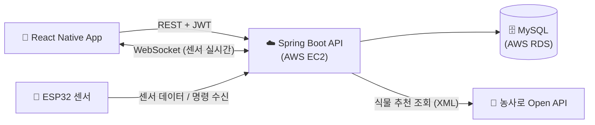
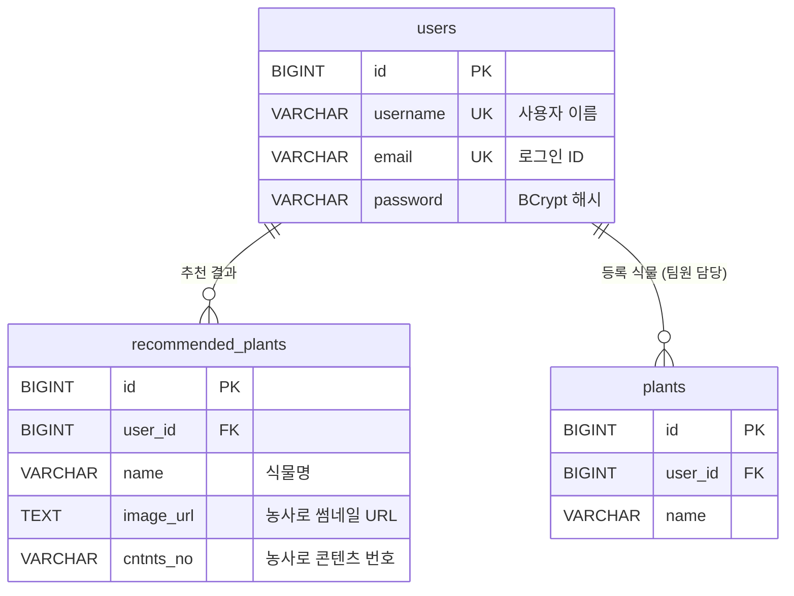

# 🌱 SPROUT — Backend API


> **IoT 기반 스마트 식물 관리 앱 Sprout의 백엔드 서버**
>
> - **기간**: 2025.03.01 ~ 2025.11.11
> - **팀 구성**: 6명 (Frontend 2 · Backend 2 · IoT/Infra 2)
> - **담당**: Backend — JWT 인증/인가, 회원 관리 API, 농사로 Open API 기반 맞춤 식물 추천, 회원·추천 도메인 DB 설계
> - **성과**: 교내 소프트웨어 경진대회 장려상

> 📌 팀 프로젝트 중 **제가 담당한 백엔드 기능**을 중심으로 정리한 포트폴리오용 저장소입니다.
> 전체 프로젝트는 [팀 원본 저장소](https://github.com/choelsol/Project_sprout)에서 볼 수 있습니다.

<br/>

## 📌 목차

1. [프로젝트 소개](#-프로젝트-소개)
2. [담당 역할 및 구현 내용](#-담당-역할-및-구현-내용)
3. [기술 스택](#-기술-스택)
4. [시스템 구조 & ERD](#-시스템-구조--erd)
5. [API 명세](#-api-명세-담당-파트)
6. [트러블슈팅](#-트러블슈팅)
7. [팀 구성](#-팀-구성)
8. [실행 방법](#-실행-방법)
9. [회고](#-회고)

<br/>

## 🌿 프로젝트 소개

**Sprout**는 IoT 센서를 활용해 실내 식물을 키우는 사용자가 **환경을 실시간으로 모니터링하고 직접 제어**할 수 있도록 돕는 스마트 식물 관리 앱입니다.

| 기능 | 설명 |
| :--- | :--- |
| 🔐 회원가입 / 로그인 | 이메일·비밀번호 기반 인증, JWT 기반 무상태 인증 |
| 🌱 맞춤 식물 추천 | 첫 실행 시 3단계 설문(설치 장소·물 주기·생육 형태)으로 식물 3종 추천 |
| 📒 식물 등록 / 성장 일지 | 반려식물 등록, 캘린더 메모 및 날짜별 스티커 |
| 📡 실시간 환경 모니터링 | 조도·온도·습도·토양 수분 실시간 확인(WebSocket), LED 조명 제어 |

> 이 중 **🔐 회원가입/로그인·회원 관리**와 **🌱 맞춤 식물 추천**의 백엔드를 제가 담당했습니다.

<br/>

## 👩‍💻 담당 역할 및 구현 내용

### 1. JWT 기반 회원 인증/인가

- **회원가입 / 로그인 API** 구현 — 회원가입 성공 시에도 바로 토큰을 발급해 별도 로그인 없이 앱 진입
- **JWT(jjwt, HS256)** 를 이용한 무상태(Stateless) 인증 — `SessionCreationPolicy.STATELESS`로 서버 세션 미사용, 토큰 유효기간 1일
- `OncePerRequestFilter`를 상속한 **`JwtAuthenticationFilter`** 구현
  - `Authorization: Bearer {token}` 헤더에서 토큰 추출 → 이메일(subject) 파싱 → DB에서 `User` 엔티티 조회
  - 조회한 **`User` 엔티티 자체를 `SecurityContext`의 Principal로 등록**해, 컨트롤러에서 `authentication.getPrincipal()`로 바로 로그인 사용자를 사용
- **Spring Security** `SecurityFilterChain`으로 공개 API(회원가입·로그인·중복 확인 등)와 인증 필요 API 분리
- 비밀번호는 **`BCryptPasswordEncoder`** 로 해시하여 저장하고, 응답 JSON에는 `@JsonIgnore`로 비밀번호가 노출되지 않도록 처리

```
[Client] ── POST /auth/login ──▶ [UserController] ── 이메일 조회 + BCrypt 검증 ──▶ [MySQL]
   ▲                                    │
   └────────── JWT(Access Token) 발급 ◀──┘

[Client] ── 요청 + Authorization: Bearer {token}
              ──▶ [JwtAuthenticationFilter] ── 토큰 파싱 → User 조회 → SecurityContext 등록
              ──▶ [Controller] (authentication.getPrincipal() = User)
```

### 2. 회원 관리 API

- 아이디(사용자 이름) / 이메일 **중복 확인 API** — 회원가입 화면에서 실시간 검증
- **회원 정보 수정** — 변경된 항목만 반영, 변경 시 중복 검사 및 비밀번호 재해시
- **회원 탈퇴** — 비밀번호 재확인 후 삭제
- 이메일 찾기, 로그인 사용자 정보 조회(`/auth/session`)

### 3. 농사로 Open API 기반 맞춤 식물 추천

- 앱 첫 실행 시 사용자가 응답한 **3가지 설문**을 농촌진흥청 **농사로 Open API(`gardenList`)** 의 검색 조건 코드로 매핑하여 조회
- XML 응답을 DOM 파서로 파싱해 **식물명·썸네일 이미지·콘텐츠 번호(`cntntsNo`)** 를 추출하고, 상위 **3종**을 추천
- 추천 결과를 사용자별로 **`recommended_plants` 테이블에 저장**하여, 검색 탭에서 다시 조회 가능 (`cntntsNo`로 상세 정보 연동)

| 설문 항목 (앱 화면) | 선택지 | 농사로 API 파라미터 |
| :--- | :--- | :--- |
| 식물을 어디에 두고 싶으세요? | 실내 / 베란다 / 실외 | `lightChkVal` (광요구도, `055001`~`055003`) |
| 얼마나 자주 물을 줄 수 있나요? | 매일 / 2~3일 / 3~5일 / 5~7일 | `waterCycleSel` (물 주기, `053001`~`053004`) |
| 원하는 식물 모양은? | 직립형 / 관목형 / 덩굴성 / 풀모양 / 로제트형 / 다육형 | `grwhstleChkVal` (생육 형태, `054001`~`054006`) |

```
[설문 응답] ──▶ POST /plants/recommendations
                 ──▶ 농사로 gardenList API 호출 (RestTemplate, 타임아웃 5초)
                 ──▶ XML 파싱 (cntntsSj, rtnThumbFileUrl, cntntsNo)
                 ──▶ 상위 3종 선정 → recommended_plants 저장 → 응답
```

### 4. 회원·추천 도메인 DB 설계

- **MySQL(AWS RDS)** 기반 `users`, `recommended_plants` 테이블 설계
- **Spring Data JPA**로 엔티티 매핑 및 Repository 구현 (`existsByEmail`, `findByEmail` 등 쿼리 메서드 활용)
- 이메일·사용자 이름에 **UNIQUE 제약**을 걸어 DB 레벨에서도 중복 가입 방지

<br/>

## 🛠 기술 스택

| 분류 | 기술 |
| :--- | :--- |
| **Language** |  |
| **Framework** |   |
| **Auth** | -000000?style=for-the-badge&logo=jsonwebtokens&logoColor=white)  |
| **Database** |   |
| **Build** |  |
| **Infra** |   |
| **External API** | 농사로 Open API (농촌진흥청) — RestTemplate, XML(DOM) 파싱 |

<details>
<summary>전체 서비스 기술 스택 (팀)</summary>

| 파트 | 기술 |
| :--- | :--- |
| Frontend | React Native (Expo), JavaScript, Axios |
| Backend | Java, Spring Boot, Spring Security, JPA, WebSocket, MySQL |
| Infra | AWS EC2, RDS |
| IoT | ESP32, Arduino (조도·온습도·토양수분 센서) |

</details>

<br/>

## 🏗 시스템 구조 & ERD

### 시스템 아키텍처



### ERD (담당 도메인)



<br/>

## 📄 API 명세 (담당 파트)

| Method | URI | 설명 | 인증 |
| :---: | :--- | :--- | :---: |
| `POST` | `/auth/register` | 회원가입 (성공 시 JWT 발급) | ❌ |
| `POST` | `/auth/login` | 로그인 (JWT 발급) | ❌ |
| `GET` | `/auth/check-username?username=` | 사용자 이름 중복 확인 | ❌ |
| `GET` | `/auth/check-email?email=` | 이메일 중복 확인 | ❌ |
| `GET` | `/auth/find-email/{username}` | 이메일 찾기 | ❌ |
| `GET` | `/auth/session` | 로그인 사용자 정보 조회 | ✅ |
| `PUT` | `/auth/update-user` | 회원 정보 수정 | ✅ |
| `POST` | `/auth/delete-account` | 회원 탈퇴 (비밀번호 재확인) | ✅ |
| `POST` | `/plants/recommendations` | 설문 응답 기반 식물 3종 추천 및 저장 | ✅ |
| `GET` | `/plants/recommendations` | 저장된 추천 식물 조회 | ✅ |

<details>
<summary>요청/응답 예시</summary>

**로그인** `POST /auth/login`

```json
// Request
{ "email": "user@example.com", "password": "********" }

// Response 200
{ "message": "Login successful!", "username": "sprout", "token": "eyJhbGciOiJIUzI1NiJ9..." }
```

**식물 추천** `POST /plants/recommendations`

```json
// Request (Authorization: Bearer {token})
{ "lightChkVal": "055001", "waterCycleSel": "053003", "grwhstleChkVal": "054001" }

// Response 200
[
  { "id": 1, "name": "산세베리아", "imageUrl": "http://www.nongsaro.go.kr/...", "cntntsNo": "12345" },
  ...
]
```

</details>

<br/>

## 🔥 트러블슈팅

### 1. 농사로 Open API의 XML 응답 처리

- **문제**: 농사로 API는 JSON이 아닌 **XML**로 응답해, 다른 REST API처럼 객체로 바로 매핑할 수 없었습니다.
- **해결**: `DocumentBuilderFactory`로 XML을 DOM으로 파싱한 뒤 `<item>` 노드를 순회하며 필요한 태그(`cntntsSj`, `rtnThumbFileUrl`, `cntntsNo`)만 추출했습니다. 값이 비어 있는 태그는 빈 문자열로 처리해 파싱 중 예외가 나지 않도록 했습니다.
- **추가 개선**: 처음에는 식물명·이미지만 저장했으나, 검색 탭에서 상세 정보를 다시 조회하려면 식별자가 필요해 **`cntntsNo`(콘텐츠 번호)를 엔티티에 추가**했습니다.

### 2. 인증된 사용자 정보를 컨트롤러에서 바로 사용하기

- **문제**: 필터에서 Spring Security 기본 `UserDetails`를 Principal로 넣으면, 컨트롤러에서 사용자 ID 등 엔티티 정보를 쓰기 위해 매번 DB를 다시 조회해야 했습니다.
- **해결**: `JwtAuthenticationFilter`에서 토큰의 이메일로 **`User` 엔티티를 조회해 Principal로 직접 등록**하여, 컨트롤러에서 `(User) authentication.getPrincipal()`로 바로 사용하도록 했습니다.
- **배운 점**: 인증 흐름(필터 → SecurityContext → 컨트롤러)을 직접 따라가 보며 Spring Security의 동작 구조를 이해하게 되었습니다.

### 3. 외부 API 지연 시 요청이 무한 대기하는 문제

- **문제**: 외부 API 응답이 늦어지면 추천 요청 스레드가 계속 대기해 앱이 멈춘 것처럼 보였습니다.
- **해결**: `RestTemplate`에 **연결·읽기 타임아웃(5초)** 을 설정해 일정 시간 안에 응답이 없으면 실패로 처리되도록 했습니다.

<br/>

## 👥 팀 구성

| 이름 | 파트 | 담당 |
| :---: | :---: | :--- |
| 민도현 ([@mindo0118](https://github.com/mindo0118)) |   | 식물 등록/성장 일지 UI, IoT 디바이스 제어 UI |
| 정현오 ([@hyeon-oo](https://github.com/hyeon-oo)) |  | 메인/시작/검색 UI, 알림 및 IoT 페이지 UI |
| **박민희 ([@minheee0](https://github.com/minheee0))** |  | **JWT 인증/인가, 회원 관리 API, 맞춤 식물 추천, 회원·추천 DB 설계** |
| 최진솔 ([@choelsol](https://github.com/choelsol)) |  | 식물 등록/성장 일지 기능, 관련 DB 설계 |
| 김다연 ([@double2-22](https://github.com/double2-22)) |  | AWS 인프라 구축, 센서 연결 및 디바이스 외형 제작 |
| 김민정 ([@gnujnim475](https://github.com/gnujnim475)) |  | AWS 인프라 구축, IoT 센서 장착 및 데이터 수집 |

<br/>

## 🚀 실행 방법

```bash
# 1. 클론
git clone https://github.com/choelsol/Project_sprout.git
cd Project_sprout/Sprout-Backend

# 2. 환경 변수 설정 (application.properties에서 ${...}로 주입)
export RDS_URL=jdbc:mysql://<host>:3306/<db>
export RDS_USERNAME=<username>
export RDS_PASSWORD=<password>
export JWT_SECRET_KEY=<32바이트 이상 임의 문자열>
export PLANT_API_KEY=<농사로 Open API 키>

# 3. 빌드 및 실행 (Java 21, 기본 포트 9090)
./gradlew clean build
./gradlew bootRun --args='--spring.profiles.active=production'
```

<br/>

## 💭 회고

- 처음으로 인증 기능을 직접 구현하며 **세션 방식과 토큰 방식의 차이**, 그리고 Spring Security 필터 체인의 동작 순서를 이해하게 되었습니다.
- 공공 데이터(농사로 API)를 서비스 데이터로 가공하면서, **외부 응답 형식(XML)·지연·누락 값**처럼 직접 통제할 수 없는 부분을 방어적으로 처리해야 한다는 것을 배웠습니다.
- 프론트엔드·IoT 팀원과 API 명세를 맞추며 **요청/응답 형식을 먼저 합의하는 것**의 중요성을 느꼈습니다.

**프로젝트 종료 후 개선한 점**

- **비밀 값 외부화** — 코드에 있던 JWT 시크릿·농사로 API 키를 환경 변수(`JWT_SECRET_KEY`, `PLANT_API_KEY`) 주입으로 변경
- **토큰 예외 응답 통일** — 만료·위조 토큰이 500 에러로 떨어지던 문제를 필터에서 처리하고, `AuthenticationEntryPoint`로 **401 + 사유 메시지(JSON)** 를 반환
- **민감 정보 로그 제거** — 요청마다 토큰 원문·Authorization 헤더를 출력하던 디버그 로그 제거
- **추천 API 인증 강제** — 임시로 공개되어 있던 `/plants/recommendations`를 인증 필요 경로로 변경 (토큰 없이 호출 시 NPE 발생하던 문제 해결)

**개선하고 싶은 점**

- **Refresh Token 도입** — 현재는 유효기간 1일의 Access Token만 사용
- **추천 로직 고도화** — 조건에 맞는 결과가 3종 미만일 때 조건을 완화해 채우는 보완 로직, 응답 캐싱
- **테스트 코드 작성** — 인증 필터와 추천 서비스에 대한 단위/통합 테스트

<br/>

## 📚 참고 자료

- [농사로 Open API](https://www.nongsaro.go.kr) — 실내정원용 식물 정보(`gardenList`) 데이터
